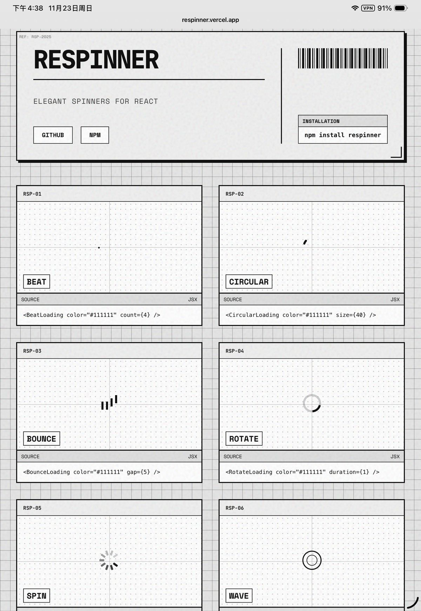
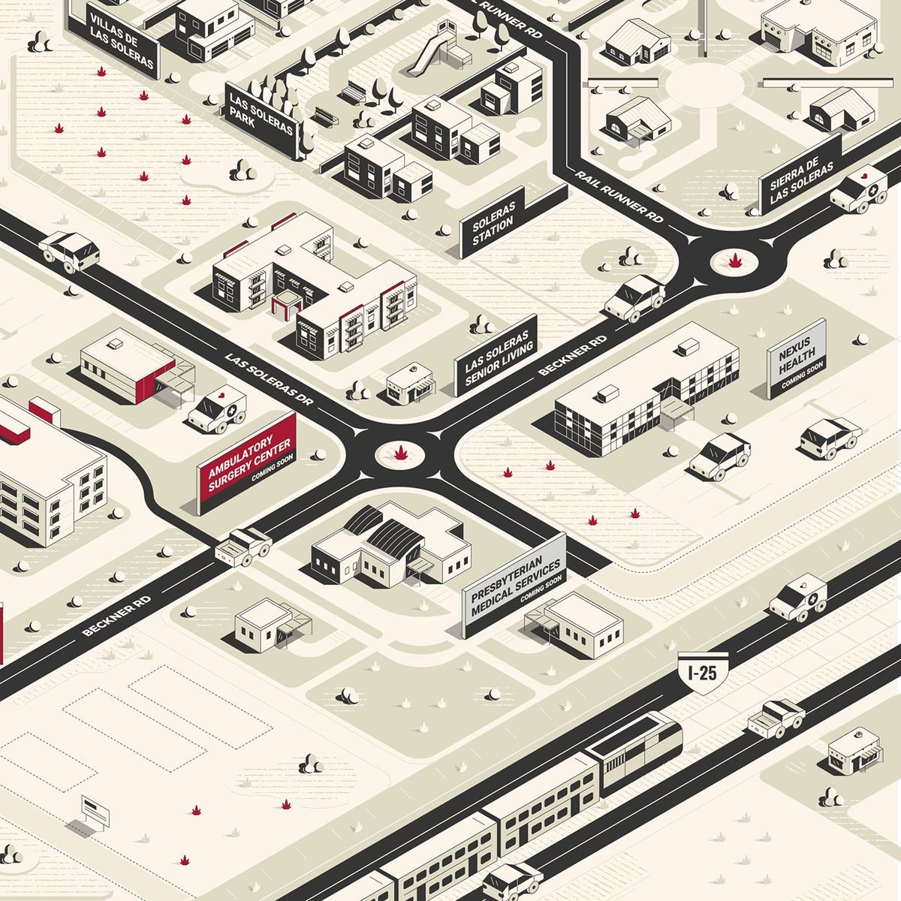
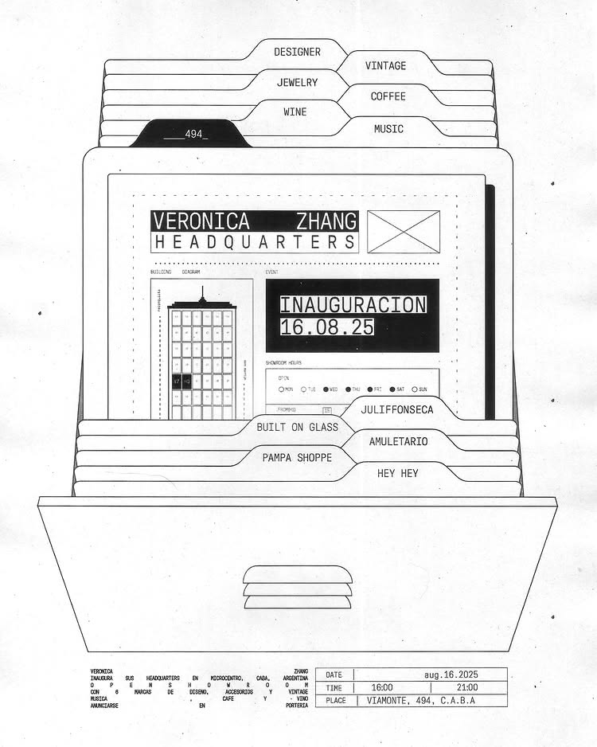

## UI inspiration
- Main canvas 
    - Grid backgound, Neo Brutalism main UI gird
- Color scheme 
    - We might want to add some color code to the UI. Refer to the text, coloring style in this figure
    - Later if we have the 3D robot visualiation, we should refer to this 3D rendering
- Drawing style UI 
    - I like the engineering drawing stlye and elemetns
    - Use the drawing style table for the system resources and status table so it's clean. Still do some color code for status