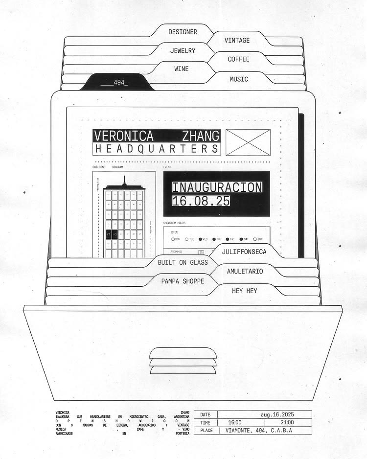
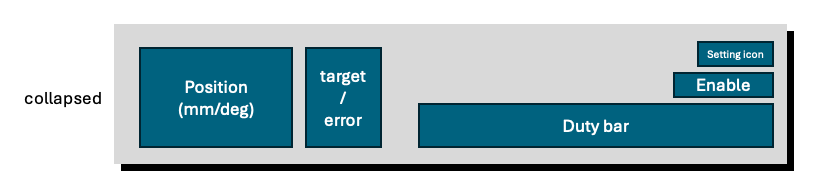
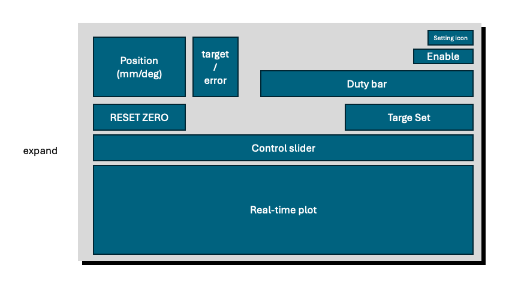
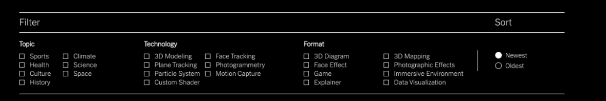

# Overall UI
- Use more real neo brutalism UI like in this page: https://marjoballabani.me/
- This is also a good example: https://kovalseo.com/. I want a mixsure of those. You can discuss with me first.
- We are still targeting neo brutalism mixxed with engineering drawing style.
- Use stronger colors to color code differnt features and status 
- Split the page into:
    - Title: keep the same 
    - Left menu bar: Keep the same, but make the style simpler. Just show the text, in this text style: 
    - Main page: display main content for each page.
    - Rigt menu bar: newly added. Shows settings or param tuning content
- In genreral, sepcify confuising detials, like frame errors from either received by Pi or the DSP; and remove repeated information, like the [01] and Axis 0 for axis numbering
- In general, no inner scroll bar. Now I see it in the robot node iframe, some expanded topic details, etc.

# Dashboard page
- Hide the robot section if the robot node is not persist
- The iframe should expand all the way. Right now there's a small vertialb inner scroller for the robot node's control iframe
- DPS block's width can be smaller, probably in half. In preview it shows only the key params and action buttons; it can be clicked to expand. The a row we should be able to fit 2 DSPs. We don't show the second one if it's not configured.
- DSP status is not clear
    - Rename states to INIT, IDLE, RUNNING, and FAULT. 
    - Create action buttons for each state. E.g., IDLE to RUNNNING (start), FAULT back to IDLE (clear fault); only show valid options when the DSP is in each state
    - We can then remove the "Enable system", it's really the DSP state
    - Some status is not clear, e.g., Invalid frames, is it the frames the DSP received? 
- For each axis, they are all collpased by default and can be expanded idividually. 
    - The new layout proposal is in  and 
    - If the setting button is pressed, highlight the one block being configured (expanded or not), and show the detials in the right panel
- For the duty bar, add another lighter shaded color bar (lb) to track the recent maximum, the logic is: 
    - If the new duty is higher or equal to current bar, lb = duty
    - If the new duty is lower, lb decades towards duty at a constant speed
    - This is the user to visualize if there's a instant peak
    - Apply this to all bars, including CPU, RAM, etc.

# Data runner and logger 
- Let's now merge data runner and logger in one page
- So the 2 work together and we can see clearly what's being ran and what's being logged 
- On the top is the runner, and bottom the logger. 
- For the runner, the UI is confusing rught now
- We need a preview for the data runner after csv loaded. With checkbox to filter signals
- For the logger, group signals rpoperly. For example there should be a group check box for axix_0, selecting it can select all default axis0 data. For DSP, we can maybe have groups like System, Errors, Encoders, etc.
- We don't need to log controller parameteres here for now. Remove them.
- For the checkbox, see the style example in 

# System page
- For system page, merge the 4 CPU bars in one block, just locaed in the current total CPU panel. 
- For ROS2 nodes and package name. 
- Why those robot node pages are UNCLASSIFIED?
- For more data, including the topic content when epxanded, put them in a minimalistic, clean table with proper indentation and grouping. I am thinking more like in the Latex table