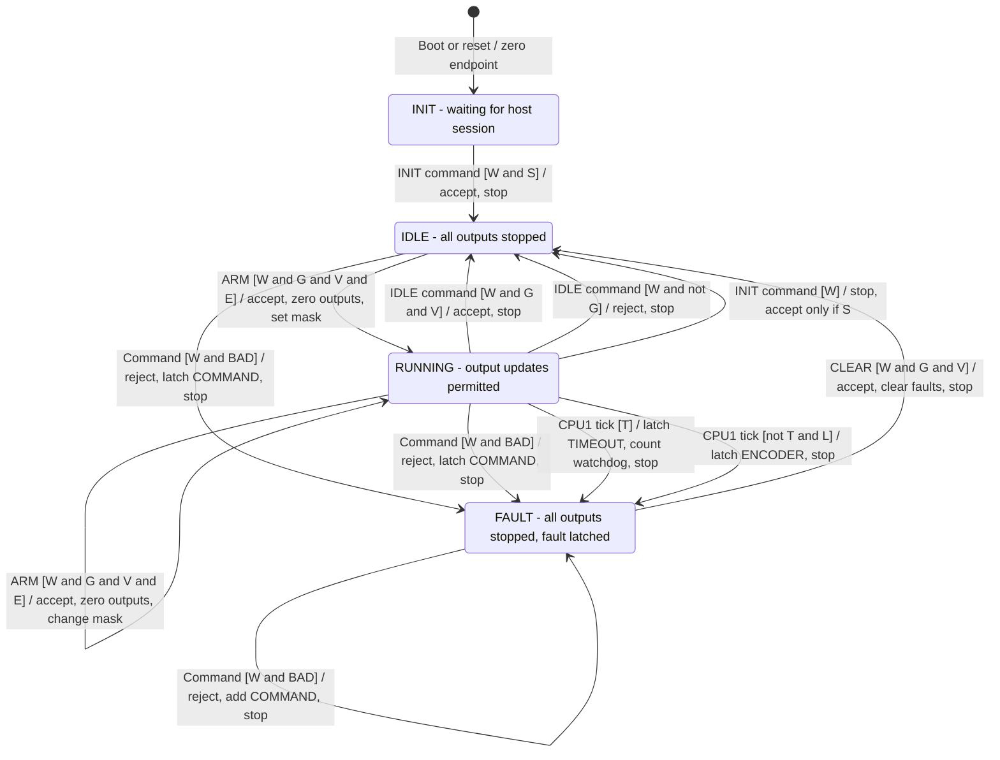

# DSP finite state machine and SPI command reference

Firmware behavior reviewed 2026-11-11. Applies to the F28379D endpoint and
**SPI protocol v5** in this repository.

**System Enable controls all output types: motors, digital outputs (DO), and
analog outputs (AO). Axis Enable selects individual motors within that global
permission.** A DSP in RUNNING can have no motors selected and still drive DO
and AO. In IDLE, all motor duties, DO and AO commands are zero.

The Pi generates position references and runs feedback controllers. The DSP
applies duty, acquires encoders and general I/O, and enforces command validity,
encoder availability and timeout protection.

## Naming used in this document

This reference adopts the requested names from the [DSP README](f28379d/README.md#4-rename-the-states):
`DISARM -> IDLE`, `ACTIVE -> RUNNING`, and `SYNC -> INIT`. This is a
**documentation naming change**. Firmware symbols, UI labels, numeric command
codes, telemetry values and behavior have not been changed.

| Meaning | Name used here | Current implementation terminology |
|---|---|---|
| Waiting for a host session after boot | **INIT state** | Unsynchronized; `synchronized=false` |
| Session established, outputs stopped | **IDLE state** | Disarmed; `synchronized=true`, `active=false`, `fault=0` |
| Output updates permitted | **RUNNING state** | Active; `active=true`, `fault=0` |
| Latched fault, outputs stopped | **FAULT state** | Fault; `fault!=0` |
| Stop-output command, code 0 | **IDLE command** | `PCD_DISARM` / `DISARM` |
| Establish-session command, code 4 | **INIT command** | `PCD_SYNC` / `SYNC` |

State names and command names are distinct uses of the same words. For example,
the **INIT command** normally moves the DSP from **INIT state** to **IDLE
state**. It leaves an existing FAULT latched. The IDLE command also preserves
FAULT; only an accepted CLEAR clears the fault latch.

`ARM`, `CYCLE` and `CLEAR` retain their existing command names. `ARM` enters
RUNNING or changes its selected motor mask. RUNNING means output updates are
permitted; it does not mean a motor must be moving or even selected.

## 1. Control states and UI output behavior

These four control states describe combinations of fields in `PcdEndpoint`.
There is no separate four-value enum in the current firmware. Session,
sequence, motor mask, output commands, timestamps and fault bits are additional
stored state, with updates specified below.

| State | Stored condition | TX `state` at word 18 | Motors | DO and AO |
|---|---|---|---|---|
| **INIT** | `synchronized=false`, `active=false`, `fault=0` | `0`, shared with IDLE | Duty zero, motor enable off | DO low; DAC codes zero |
| **IDLE** | `synchronized=true`, `active=false`, `fault=0` | `0` | Duty zero, motor enable off | DO low; DAC codes zero |
| **RUNNING** | `synchronized=true`, `active=true`, `fault=0` | `1` | Only mask-selected motors can receive duty; mask zero is allowed | CYCLE can update DO and DAC commands independently of motor selection |
| **FAULT** | `synchronized=true`, `active=false`, `fault!=0` | `2` | Duty zero, motor enable off | DO low; DAC codes zero; fault latched |

Normal boot zero-initializes the endpoint and enters INIT. Reset returns any
state to INIT. Before the first accepted INIT command, the telemetry session
and command acknowledgment are both zero. TX state value 0 alone cannot
distinguish INIT from IDLE.

### System Enable versus Axis Enable

The UI sends requests through the UI bridge to the control bridge. The control
bridge owns the requested System Enable and per-axis selections, validates
enabling, and builds the requested motor mask. The DSP independently validates
the resulting SPI commands and applies its own mask and safety rules.

The table assumes a connected physical DSP, established session, no fault,
accepted commands, and completion of the output-update tick. Communication and
telemetry introduce transition delays; the UI request is not an instantaneous
hardware state change.

| UI request | Bridge command sequence in this document's names | Resulting DSP state | Motors | DO / AO |
|---|---|---|---|---|
| System Enable **off**, with any axis selections | IDLE | IDLE | All disabled | All DO low; both DAC codes zero |
| System Enable **on**, every axis disabled | ARM with `mask=0`, then CYCLE | RUNNING | All disabled | Can be updated through the UI |
| System Enable **on**, one or more axes enabled | ARM with selected bits, then CYCLE | RUNNING | Only selected motors can receive duty | Can be updated through the UI |
| Disable one axis while System Enable stays on | ARM with that bit removed, then CYCLE | RUNNING | That motor disabled; remaining mask bits retained | Can be updated through the UI |
| Disable the last axis while System Enable stays on | ARM with `mask=0`, then CYCLE | RUNNING | All disabled | Still permitted; this is I/O-only operation |
| Stop All | IDLE after clearing bridge selections and output commands | IDLE, unless a fault remains latched | All disabled | All DO low; both DAC codes zero |
| DSP fault | DSP's local fault branch stops outputs; bridge subsequently disables the system | FAULT | All disabled | All DO low; both DAC codes zero |

Turning System Enable off preserves the bridge's axis selections but clears
its DO/AO commands. The DSP receives IDLE and clears all outputs. Turning it
back on revalidates the selected motors and sends ARM before cyclic updates.
Stop All also clears the axis selections. A fault remains FAULT when IDLE is
sent; disabling the system does not clear that latch.

For **I/O-only operation**, keep System Enable on and leave every axis disabled.
The DSP is RUNNING with `mask=0`. Mask zero does not suppress DO/AO, and the
50 ms RUNNING watchdog still applies. Turning System Enable off also prevents
new DO/AO requests in the bridge.

Changing an axis selection while RUNNING causes another ARM. ARM zeros all
stored DSP output commands, including DO/AO; following CYCLE commands can
restore the bridge's requested output values. The physical timing of that
intermediate zero is described in section 6.

**AO stopped means DAC code zero.** It does not switch off the DAC peripheral.
DI, ADC and encoder acquisition continue in INIT, IDLE, RUNNING and FAULT while
the firmware is executing.

### Requested selection versus confirmed state

The UI axis checkbox displays the bridge's `selected` flag through
`axis_enabled`; it is not an acknowledgment from the DSP. An axis can remain
checked while System Enable is off. The DSP's reported `dsp_arm_mask` is the
confirmed software motor mask, and `dsp_state` / `dsp_fault` report the DSP's
control state and fault latch. Physical voltage/current feedback is not implied.

### Condition definitions

The letters below are shorthand used in the diagram and command tables.
**G means the session and sequence guard. V means payload validation.** They
are documentation labels, not firmware variables. Here, `c` is the decoded
command, `e` is the endpoint, and `now` is the DSP microsecond timestamp.

| Label | Meaning | Exact condition |
|---|---|---|
| **W** | Complete, decodable wire frame | RX completion predicate passes; header `0x55AA`, version `5`, length `96`, CRC and reserved zeros pass. No endpoint dispatch occurs without W. |
| **G** | Current session and advancing sequence | `e.synchronized && c.session == e.command.session && (int32_t)(c.sequence - e.command.sequence) > 0` |
| **V** | Valid payload for a non-INIT command | Operation is `0..3`; `arm_mask <= 63`; `digital_out <= 15`; each DAC code is `<= 4095`; every duty satisfies `d >= -1.0f && d <= 1.0f`. NaN and infinities fail. References have no semantic range check. |
| **S** | Acceptable INIT session and sequence | `c.session != 0` and either the endpoint is not synchronized, the session differs, or the sequence advances by the signed-difference rule in G. |
| **E** | Every requested motor encoder is available | `(c.arm_mask & ~encoder_valid) == 0` |
| **M** | Incoming motor mask matches the RUNNING motor mask | `c.arm_mask == e.mask` |
| **T** | RUNNING command timeout is due | `e.active && (uint32_t)(now - e.last_update_us) > 50000` |
| **L** | A selected motor encoder is unavailable | `(e.mask & ~encoder_valid) != 0` |
| **BAD** | Semantic command error | A decoded non-INIT command passes G and then fails V, or reaches a command-specific error branch below. |

The command-specific BAD branches, after G and V pass, are:

1. CLEAR while RUNNING (`e.active=true`).
2. ARM with an unavailable requested motor encoder (E false), when `e.fault=0`.
3. CYCLE outside RUNNING or with a different mask (M false), when `e.fault=0`.

Existing faults reject otherwise valid ARM and CYCLE before their
command-specific checks. V is checked before that fault gate, so an invalid
payload can add a command fault to an existing fault. V covers all fields even
when the command later zeros or ignores them. INIT bypasses V, but still needs
W and S for acceptance.

### State diagram

Square brackets contain conditions defined above. **Accept** updates the
session/sequence acknowledgment and accepted-update time; **reject** does
neither. **Stop** zeros all output commands and clears the motor mask, with
physical writes on the next CPU1 tick unless another command supersedes it.
All command names in this diagram use the new documentation names.



The diagram covers state-changing paths and RUNNING output updates. Other
same-state accepts and rejections appear in the complete tables below. Reset
returns any state to INIT. A zero motor mask is still RUNNING, not IDLE.

### Complete command transition matrix

Assume W and valid payload ranges. In states with an established session,
non-INIT commands use the current session and an advancing sequence. Assume S
for INIT, E for ARM, and M for CYCLE in RUNNING. INIT state always fails G for
commands other than INIT.

| Command | INIT state | IDLE state | RUNNING state | FAULT state |
|---|---|---|---|---|
| IDLE | INIT, reject | IDLE, accept | IDLE, accept | FAULT, accept |
| ARM | INIT, reject | RUNNING, accept | RUNNING, accept | FAULT, reject |
| CYCLE | INIT, reject | FAULT, reject and latch COMMAND | RUNNING, accept | FAULT, reject |
| CLEAR | INIT, reject | IDLE, accept | FAULT, reject and latch COMMAND | IDLE, accept |
| INIT | IDLE, accept | IDLE, accept | IDLE, accept | FAULT, accept |

| Other event | State and output effect | Acknowledgment and diagnostics |
|---|---|---|
| W fails | No endpoint change; even an IDLE or INIT command cannot stop through an undecodable frame | Driver `invalid_frames` increases; endpoint `rejected_commands` does not |
| G fails for an operation other than IDLE or INIT | No state or output change; V is not evaluated | Reject; `rejected_commands += 1`; no watchdog refresh |
| G fails for IDLE | Stop first: RUNNING becomes IDLE; INIT, IDLE and FAULT retain their state | Reject; `rejected_commands += 1`; session/sequence unchanged |
| S fails for INIT | Stop first: RUNNING becomes IDLE; INIT, IDLE and FAULT retain their state | Reject; `rejected_commands += 1`; session/sequence unchanged |
| BAD | IDLE or RUNNING becomes FAULT; FAULT stays FAULT; OR COMMAND into fault and stop | Reject; `rejected_commands += 1`; no watchdog refresh |
| Valid ARM or CYCLE in FAULT | Stay FAULT; outputs stopped and existing faults retained | Reject; `rejected_commands += 1`; no watchdog refresh |
| T on a CPU1 tick | RUNNING becomes FAULT; OR TIMEOUT into fault and stop | `watchdogs += 1`; no command rejection |
| L after the timeout check | RUNNING becomes FAULT; OR ENCODER into fault and stop | No watchdog or rejected-command increment |
| DSP reset | Any state becomes INIT; software outputs, faults, session and sequence zero | Endpoint and SPI driver counters reset |

## 2. All commands

Numeric command codes occupy RX word 3. All commands use the same frame layout
in section 5. G, V, S, E and M are defined above. The command names here use
the README terminology: code `0` is documented as `IDLE` and code `4` as `INIT`;
the current source still names them `PCD_DISARM` and `PCD_SYNC`.

| Code | Command | Acceptance conditions after W | Effect when accepted | Rejection behavior |
|---|---|---|---|---|
| `0` | `IDLE` | G and V; allowed in IDLE, RUNNING and FAULT | Store command, stop; retain faults and synchronization | Stop occurs **before** G and V. G failure rejects without a new fault. V failure after G adds COMMAND. |
| `1` | `ARM` | G, V, no existing fault, and E | Store command; zero motor duties, DO and DAC commands; set `mask=c.arm_mask`, `active=true` | G failure rejects. V failure or unavailable requested encoder latches COMMAND. Otherwise valid `ARM` in FAULT simply rejects. |
| `2` | `CYCLE` | G, V, no existing fault, `active=true`, and M | Store duty, DO, DAC and reference fields; remain RUNNING | G failure rejects. V failure, inactive state or mask mismatch latches COMMAND when the corresponding branch is reached. Otherwise valid `CYCLE` in FAULT simply rejects. |
| `3` | `CLEAR` | G, V and `active=false`; allowed in IDLE and FAULT | Clear all fault bits, store command, stop; end in IDLE | G failure rejects. V failure or `CLEAR` while RUNNING latches COMMAND and stops. |
| `4` | `INIT` | S; G and V are not required | Stop, store new command/session/sequence, stop again, set `synchronized=true`; preserve faults | Stop occurs **before** S. Zero session or stale same-session sequence rejects without replacing the acknowledgment anchor. |

An accepted `ARM` may change the mask while already RUNNING. An accepted
`CYCLE` cannot change it. `ARM` with mask zero enters RUNNING for I/O-only operation;
its 50 ms watchdog is still active.

An unknown operation code first has to pass G; if it does, it fails V and
latches COMMAND. A foreign-session unknown operation is rejected at G without
reaching that fault branch.

## 3. Ordered dispatcher and side effects

The pseudocode uses the new command names. The implementation still uses the
old symbols; `active` below remains the actual boolean field that means
RUNNING, and `synchronized` means a host session has been established.

Validation order is part of the behavior. The following reproduces
`pcd_accept` from [the shared endpoint](common/endpoint.h).

```text
On a decoded command c:

1. If operation is IDLE, stop immediately.
2. If operation is INIT:
     stop;
     if S is false, reject;
     store c, then stop again;
     set synchronized=true and last_update_us=now;
     accept and return.
3. If G is false, reject.
4. If V is false, take the COMMAND fault branch.
5. If operation is CLEAR:
     if active, take the COMMAND fault branch;
     clear fault, store c, and stop.
6. Else if operation is IDLE:
     store c and stop.
7. Else if fault != 0:
     reject.
8. Else if operation is ARM:
     if E is false, take the COMMAND fault branch;
     store c and stop;
     set mask=c.arm_mask and active=true.
9. Else (operation must be CYCLE):
     if not active or M is false, take the COMMAND fault branch;
     store c.
10. Set last_update_us=now, accept and return.

Reject:
  Increment rejected_commands and return false.

COMMAND fault branch:
  Increment rejected_commands, OR COMMAND into fault, stop, return false.
```

### Software stop

`pcd_stop` changes these endpoint fields:

```text
mask = 0
active = false
command.duty[0..5] = 0
command.digital_out = 0
command.analog_out[0..1] = 0
```

It preserves synchronization, fault bits, session, command sequence, stored
operation, stored `command.arm_mask`, references, accepted-update time and
counters. The separate `e.mask` is the applied motor selection; the stored
`command.arm_mask` is not used as the applied mask after a stop.

### Acceptance and acknowledgment

Every accepted command stores `c`, subject to the zeroing above, and updates
`last_update_us`. Telemetry echoes that stored session and sequence as its
acknowledgment. `INIT` and `ARM` are acknowledged even though their incoming
output values are zeroed.

An endpoint rejection preserves the stored session/sequence and accepted-update
time. It can still stop or zero outputs, or add a fault, as specified above.
A driver rejection before dispatch does not execute `pcd_stop`.

## 4. Faults and periodic safety checks

`fault` is a latched bitmask, not a single error enum.

| Bit index | Value | Name | Trigger | Additional effect |
|---|---|---|---|---|
| 0 | `0x0001` | `PCD_FAULT_TIMEOUT` | T during `pcd_tick` | Increment `watchdogs`, then stop |
| 1 | `0x0002` | `PCD_FAULT_COMMAND` | BAD during command dispatch | Increment `rejected_commands`, then stop |
| 2 | `0x0004` | `PCD_FAULT_ENCODER` | L during `pcd_tick`, after the timeout check | Stop; no command-rejection increment |

An accepted `CLEAR` clears all bits and ends in IDLE. `INIT` and `IDLE`
preserve faults. DSP reset also clears faults and counters. `CLEAR` does not
reset lifetime diagnostics or encoder counts.

### What a tick is

A **tick** is one execution of CPU1's Timer0 interrupt handler, scheduled at
**5 kHz**, approximately every **200 us**. It runs independently of incoming
SPI transactions, so timeout protection continues when the Pi stops sending.
CPU2's fast encoder polling loop is separate from this CPU1 timer interrupt.

Command errors are detected when a decoded SPI command is dispatched at the
end of its transaction. Timeout and encoder-availability faults are detected
on CPU1 ticks. The tick performs physical output writes after its safety checks.

### Tick order and thresholds

Each CPU1 tick performs these steps:

1. Refresh encoder positions and availability.
2. Run `pcd_tick`: check T first, then L.
3. Reconcile changes in the applied motor mask.
4. Apply motor duties, digital outputs and DAC commands; sample general inputs.
5. Build and encode a telemetry snapshot.

The timeout threshold is **strictly greater than 50000 us** since the last
accepted command while RUNNING. Exactly 50000 us does not trip. Duplicate,
foreign-session, malformed and otherwise rejected commands do not refresh it.
INIT, IDLE and FAULT are not watched; RUNNING with a zero motor mask is watched.

If T and L would both apply on the same tick, timeout wins: its stop clears
`mask`, so the following encoder check sees no armed bits and does not add
ENCODER. Subsequent ticks do not repeatedly increment the watchdog counter
because the endpoint is no longer RUNNING.

All timestamp ages use unsigned 32-bit subtraction. Sequence advancement uses
a signed interpretation of a 32-bit difference; see section 7.

### Encoder availability

The current driver advertises axes 0-2 as available. Axes 3-5 become available
together when CPU1 has observed a coherent, nonzero CPU2 snapshot sequence and
the unsigned age of its last observed sequence advance is **less than 10000
us**. At exactly 10000 us those bits are removed. The reported mask is
therefore `0x07` or `0x3F`.

A coherent CPU2 snapshot needs the expected ABI version, a slot index below 2,
a nonzero even sequence, matching begin/end sequences, and an unchanged slot
and begin sequence during the read. CPU2 publishes at nominal 5 kHz.

Encoder error counters alone do not clear availability or latch ENCODER.
Availability indicates an acquisition path and CPU2 freshness; it does not
prove an external encoder is connected.

## 5. Complete SPI wire layouts

RX and TX below are named from the **DSP's perspective**:

- **DSP RX:** Pi to DSP commands.
- **DSP TX:** DSP to Pi telemetry.

Each full-duplex transaction clocks **96 words / 192 bytes**. All offsets are
**zero-based 16-bit word offsets**, not byte offsets. Words are transmitted MSB
first. A 32-bit value occupies two words, **low word then high word**. Signed
counts use int32 two's complement; duties use IEEE 754 binary32.

CRC is CRC-16/CCITT-FALSE: polynomial `0x1021`, initial value `0xFFFF`, no
reflection and no final XOR. Each word feeds its high byte before its low byte.

### DSP RX command frame

| Word(s) | Field | Type / meaning |
|---|---|---|
| 0 | Header | `0x55AA` |
| 1 | Protocol version | `5` |
| 2 | Total frame words | `96` |
| 3 | `operation` | Documentation names: `IDLE=0`, `ARM=1`, `CYCLE=2`, `CLEAR=3`, `INIT=4`; current source calls codes 0/4 `DISARM`/`SYNC` |
| 4-5 | `session` | uint32 host session ID; accepted `INIT` requires nonzero |
| 6-7 | `sequence` | uint32 command sequence |
| 8 | `arm_mask` | uint16, motor bits 0-5; V requires `0..63` |
| 9 | `digital_out` | uint16, DO bits 0-3; V requires `0..15` |
| 10-11 | `analog_out[0..1]` | One uint16 DAC code per channel; V requires `0..4095` |
| 12-23 | `duty[0..5]` | Six float32 values; axis `i` starts at word `12 + 2*i`; V requires finite `[-1,+1]` |
| 24-35 | `reference[0..5]` | Six int32 host references; axis `i` starts at word `24 + 2*i`; echoed only |
| 36-94 | Reserved | All words must be zero, including for `INIT` |
| 95 | CRC | CRC over words `0..94` |

### DSP TX telemetry frame

These are the nominal TX buffer offsets. The host can align a shifted header
only when the complete versioned payload and CRC fit in the received frame.

| Word(s) | Field | Type / meaning |
|---|---|---|
| 0-3 | Pipeline padding | Each word `0xFFFF` |
| 4 | Header | `0xAA55` |
| 5 | Protocol version | `5` |
| 6 | Total frame words | `96` |
| 7 | Device ID | `0x2837` |
| 8 | Firmware ID | `0x0100` |
| 9 | Capabilities | `0x000F`: duty, encoders, digital I/O and analog I/O; no FOC |
| 10-11 | `timestamp_us` | uint32 snapshot start time in microseconds |
| 12-13 | `sequence` | uint32 snapshot counter, incremented every CPU1 tick |
| 14-15 | `session` | uint32 current stored host session; zero before accepted `INIT` |
| 16-17 | `command_sequence` | uint32 last accepted command sequence |
| 18 | `state` | uint16: `0` IDLE or INIT, `1` RUNNING, `2` FAULT; INIT has no separate wire state value |
| 19 | `arm_mask` | uint16 applied endpoint motor mask, `e.mask` |
| 20 | `fault` | uint16 latched fault bitmask from section 4 |
| 21 | `encoder_valid` | uint16 availability bits 0-5; currently `0x07` or `0x3F` |
| 22 | `digital_in` | uint16 sampled DI bits 0-3 |
| 23 | `digital_out` | uint16 software DO command bits 0-3, written during the tick |
| 24 | `analog_valid` | uint16 ADC freshness bits 0-5; `0x3F` when a completed acquisition is consumed this tick, otherwise `0` |
| 25 | `analog_out_valid` | uint16 DAC validity bits 0-1; current firmware sets `0x03`, including when outputs are zero |
| 26-31 | `analog_in[0..5]` | Six uint16 raw ADC results, `0..4095`; channel `i` occupies word `26 + i` |
| 32-33 | `analog_out[0..1]` | Two uint16 software DAC command codes, `0..4095`; channel `i` occupies word `32 + i` |
| 34-45 | `position[0..5]` | Six int32 encoder counts; axis `i` starts at word `34 + 2*i` |
| 46-57 | `requested_duty[0..5]` | Six float32 stored requested duties; axis `i` starts at word `46 + 2*i` |
| 58-69 | `duty[0..5]` | Six float32 applied software duties; axis `i` starts at word `58 + 2*i`; zero for motors outside `arm_mask` |
| 70-81 | `reference[0..5]` | Six int32 echoed host references; axis `i` starts at word `70 + 2*i`; no DSP setpoint action |
| 82-83 | `invalid_frames` | uint32 sum of SPI driver `crc_errors + frame_errors` |
| 84-85 | `rejected_commands` | uint32 endpoint rejection counter |
| 86-87 | `watchdogs` | uint32 active command timeout trip count |
| 88-89 | `encoder_errors` | uint32 sum of the six encoder error counters |
| 90 | Wiring configuration ID | `1` |
| 91 | `cpu2_max_poll_us` | uint16 maximum CPU2 polling gap, rounded up from 200 MHz CPU cycles using `(max_poll_cycles + 199) / 200` |
| 92 | CRC | CRC over words `4..91` |
| 93-95 | Trailing padding | Zero |

`requested_duty` reflects stored endpoint values **after** stop/arm zeroing; it
is not a permanent record of the last received payload. `duty` additionally
masks out unarmed motors. These values and DO/DAC fields are software commands,
not measured pin voltage, current or torque.

When `analog_valid=0`, ADC fields retain previous samples and must not be
treated as fresh. DAC validity indicates the configured output channels, not
measured voltage or connection status. ADC validity indicates acquisition
completion, not calibration or an external connection.

### Pending layout changes

The README proposes moving the TX CRC to word 95 while retaining a 96-word
frame. That is a future protocol change. **Current v5 still uses TX CRC at 92
and RX CRC at 95**, as documented above; this naming pass changes neither.

### Deferred reference field removal

RX words **24-35** and TX words **70-81** are still present in v5. The DSP only
stores and echoes these host references; neither control nor safety needs
them. Removing them is a known issue deferred to a coordinated future
host/firmware protocol update. The Pi still needs its own local reference
generation. See [the DSP README known issue](f28379d/README.md#1-unnecessary-position-references-in-spi-frames).

## 6. SPI transport and physical timing

### Transport state machine

`g_cs_active` is a separate two-state transport flag, independent of the four
control states. Its between-frames state does not mean DSP IDLE. DMA is armed before CS falls; the GPIO40 CS mirror interrupt
handles frame boundaries.

| Transport state | Observed CS event | Action and next state |
|---|---|---|
| Between frames, `g_cs_active=false` | Falling / low | Set true, increment falling-edge count; enter transfer state |
| Transfer, `g_cs_active=true` | Falling / low | Count ignored edge; stay in transfer state |
| Transfer, `g_cs_active=true` | Rising / high | Set false; capture RX completion; stop DMA; swap RX buffers; decode/dispatch if complete; count TX frame; swap ready TX buffer; rearm DMA; enter between-frames state |
| Between frames, `g_cs_active=false` | Rising / high | Count ignored edge; stay between frames |

The RX completion predicate is:

```text
RX DMA is no longer running
AND RX DMA overflow is absent
AND SPI RX FIFO is empty
```

Failure increments `frame_errors` without dispatch. If completion passes but
decoding fails, `crc_errors` increments; this counter also includes header,
version, length and reserved-word decoder failures. A decoded command counts
as a driver RX frame even if the endpoint rejects its session or semantics.

### Physical output application

Command dispatch at CS rising changes endpoint state. It does not directly
call `Motor_stop` or write general I/O. The next CPU1 tick performs safety
checks, reconciles the motor mask, writes duties and I/O, then builds telemetry.

If `e.mask != applied_mask`, that tick calls `Motor_stop` and then, for a
nonzero new mask, `Motor_arm`. STBY follows the selected motor bits and shared
EN is high only for a nonzero motor mask. A RUNNING I/O-only state keeps motors
disabled while permitting DO and DAC updates.

Several commands can update the endpoint between ticks. Only the final stored
values are applied. For example, stop, re-arm and `CYCLE` before the next tick
can overwrite an intermediate software stop; the dispatcher does not guarantee
a physical off interval. Re-arming an unchanged mask does not force mask
reconciliation, although `ARM` zeros stored duties and I/O commands.

### Pipelined telemetry

CPU1 encodes snapshots into the standby TX buffer. At CS rising, the driver
swaps in that buffer if a new snapshot is ready. Telemetry shifted during a
transaction was prepared before that transaction ended and cannot acknowledge
the command dispatched at its end. Check `session` and `command_sequence` in
later telemetry to determine acceptance.

The snapshot combines the latest available encoder and analog data. Its single
timestamp does not imply simultaneous physical sampling of all channels.

## 7. Session sequencing and recovery

For the current session, sequence advancement is:

```c
(int32_t)(incoming_sequence - stored_sequence) > 0
```

The subtraction is between uint32 values. Forward distances `1..0x7FFFFFFF`
pass; equal, backward and half-range distances reject. Wrap from
`0xFFFFFFFF` to `0` passes. A fresh or different nonzero session accepted by
`INIT` can use any sequence, including zero. The DSP retains only the current
session; it does not remember or blacklist older sessions.

The Pi creates a session per `SpiLink` from a truncated steady-clock count OR
`1`. This makes it nonzero without guaranteeing global uniqueness. The host
repeats `INIT` until telemetry echoes its ID, then sends the requested
operation. It checks advancing telemetry timestamps and snapshot sequences,
session changes after synchronization, and more than **20 ms** without an
acknowledged command sequence change. These host checks are separate from the
DSP's **50 ms** RUNNING watchdog.

For recovery from FAULT in the current session, send an advancing, valid `CLEAR`,
then `ARM`, then `CYCLE`. If a new session is needed, send `INIT` first; it
preserves the fault latch. `CLEAR` alone does not enable outputs.

A DSP reboot clears its session and telemetry epoch. Automatic host
resynchronization after that reset is unimplemented. Restart the bridge after
the DSP has booted to establish a new session in IDLE.

| Starting point | Command traffic | Result |
|---|---|---|
| Boot INIT | `INIT(s=10,q=1)`, `ARM(s=10,q=2,mask=1)` | IDLE then RUNNING; output commands remain zero until `CYCLE` |
| RUNNING, stored `(s=10,q=3)` | Duplicate `CYCLE(s=10,q=3)` | Reject, stay RUNNING; no watchdog refresh |
| RUNNING, stored `(s=10,q=3)` | Stale `INIT(s=10,q=1)` | Reject, stop to IDLE; stored sequence remains 3; old `ARM(q=2)` still rejects |
| RUNNING, stored session 10 | `INIT(s=20,q=0)` | Accept, stop to IDLE; acknowledgment anchor becomes `(20,0)` |
| FAULT, stored session 20 | `INIT(s=30,q=1)`, `CLEAR(s=30,q=2)`, `ARM(s=30,q=3)` | FAULT then IDLE then RUNNING, with valid payloads and available requested encoders |

## 8. Implementation sources and verification

| Source | Behavior defined |
|---|---|
| [Shared endpoint](common/endpoint.h) | State fields, stop, command dispatch, rejection and periodic safety rules |
| [Shared protocol](common/protocol.h) | Command codes, wire packing, CRC, fault values and telemetry fields |
| [CPU1 main](f28379d/cpu1/main.c) | Boot, tick ordering, motor masking, telemetry assembly |
| [SPI driver](f28379d/cpu1/spi_dma.c) | Frame completion, CS state, decode dispatch, buffer swaps and counters |
| [Motor driver](f28379d/cpu1/motor.c) | PWM, DIR, STBY and shared enable writes |
| [I/O driver](f28379d/cpu1/io.c) | DI/DO, ADC freshness, DAC writes and validity fields |
| [CPU1 encoder driver](f28379d/cpu1/encoders.c) | Encoder counts, CPU2 snapshot coherence and availability timeout |
| [CPU2 main](f28379d/cpu2/main.c) | Encoder polling and snapshot publication |
| [Bridge control](../ros2_ws/src/bridge/include/bridge/control.hpp) | System/axis enable policy, requested motor mask and DO/AO command gating |
| [Bridge worker and published state](../ros2_ws/src/bridge/src/bridge_node.cpp) | Choosing IDLE/ARM/CYCLE/CLEAR wire commands, requested selections and confirmed DSP fields |
| [Web UI](../web_ui/src/main.ts) | Enable controls and displayed axis selection |
| [Pi transport](host/spi.hpp) | Host session generation, synchronization, acknowledgment and stale-data checks |
| [Protocol test](../tests/protocol_test.cpp) | Packing, CRC, corrupt frames, reserved fields and endpoint checks |

The shared protocol test passed during this documentation work. A temporary
host-compiled check also passed all 20 control-state/command combinations and edge
cases for stale stops, `INIT` validation bypass, fault precedence, watchdog
boundary, sequence wrap and I/O-only operation. No new physical hardware run
was performed. The source files above remain authoritative as firmware evolves.
