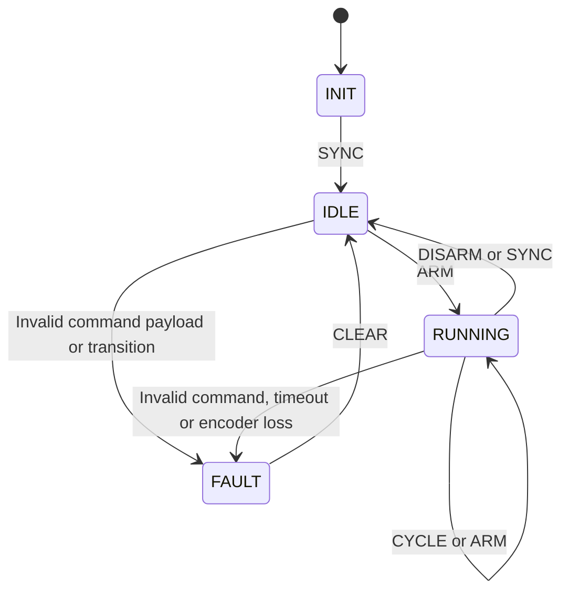

# DSP endpoint and SPI v5

The Pi sends duty and I/O commands to CPU1. CPU1 checks each completed frame, applies accepted outputs on its 5 kHz tick and prepares the next telemetry snapshot. The Pi closes the position loop. The six position references in the frame are echoed for observation.

## States and commands

The UI names the states **INIT**, **IDLE**, **RUNNING** and **FAULT**. The wire encodes INIT and IDLE as state 0. At boot the session is zero. Once synchronized, the DSP echoes the active nonzero host session. RUNNING is state 1 and FAULT is state 2.

| Wire command | Behavior |
|---|---|
| `DISARM` (0) | Removes drive as soon as a frame decodes, even if the session or sequence is subsequently rejected. A valid stop leaves the fault latch intact. |
| `ARM` (1) | Requires a synchronized, fault-free endpoint and valid encoders for every requested motor. Clears output commands and sets the new mask. A zero mask permits DO/DAC updates with all motors disabled. |
| `CYCLE` (2) | Requires RUNNING and the currently armed mask. Stores duty, DO and DAC commands for the next CPU1 tick. |
| `CLEAR` (3) | Requires stopped outputs and a valid command. Clears fault bits and leaves outputs zero. Diagnostic counters persist. A clear while active is a command fault. |
| `SYNC` (4) | Stops first. A fresh nonzero session can start at any sequence. The existing session requires an advancing sequence. Preserves a latched fault. |

Only a fully decoded frame reaches this table. A stale or foreign ordinary command increments the rejection count and leaves the acknowledged sequence unchanged. Sequence comparison uses a signed 32-bit difference, so wraparound is supported. For all commands except SYNC the endpoint also validates the mask, digital bits, both DACs and all six duties. A bad payload or invalid operating transition latches the command fault. SYNC ignores output payload values and writes zeros.

| Fault bit | Trigger | Result |
|---|---|---|
| `0x01` | More than 50,000 µs since the last accepted update while active | Stop and increment the command-timeout counter |
| `0x02` | Invalid payload, ARM requests unavailable encoders, or invalid transition | Reject the command and stop |
| `0x04` | An armed encoder becomes unavailable at a CPU1 tick | Stop |

A stop clears the mask, motor duties, digital outputs and DAC codes. The next CPU1 tick writes the resulting values to the pins. Shared motor EN follows a nonzero mask and STBY follows each selected axis. Input acquisition continues in every state.

## Frames

SPI uses 96 words per full-duplex exchange (192 bytes), 16 bits per word, MSB first, Linux mode 1 at 10 MHz. All offsets below are zero-based words. Multiword fields use low word first. Counts are signed 32-bit integers and duties use IEEE 754 binary32. CRC-16/CCITT-FALSE processes the high byte of each word first, with polynomial `0x1021`, initial value `0xFFFF`, no reflection and no final XOR.

### DSP RX command frame

| Word(s) | Field | Type / meaning |
|---|---|---|
| 0 | Header | `0x55AA` |
| 1 | Protocol version | `5` |
| 2 | Total frame words | `96` |
| 3 | `operation` | `DISARM=0`, `ARM=1`, `CYCLE=2`, `CLEAR=3`, `SYNC=4` |
| 4-5 | `session` | uint32 host session ID; accepted `SYNC` requires nonzero |
| 6-7 | `sequence` | uint32 command sequence |
| 8 | `arm_mask` | uint16, motor bits 0-5; valid range `0..63` |
| 9 | `digital_out` | uint16, DO bits 0-3; valid range `0..15` |
| 10-11 | `analog_out[0..1]` | One uint16 DAC code per channel; valid range `0..4095` |
| 12-23 | `duty[0..5]` | Six float32 values; axis `i` starts at word `12 + 2*i`; finite `[-1,+1]` |
| 24-35 | `reference[0..5]` | Six int32 host references; axis `i` starts at word `24 + 2*i`; echoed only |
| 36-94 | Reserved | All words must be zero, including for `SYNC` |
| 95 | CRC | CRC over words `0..94` |

### DSP TX telemetry frame

These are the nominal TX buffer offsets. The host can align a shifted header
only when the complete versioned payload and CRC fit in the received frame.

| Word(s) | Field | Type / meaning |
|---|---|---|
| 0-3 | Pipeline padding | Each word `0xFFFF` |
| 4 | Header | `0xAA55` |
| 5 | Protocol version | `5` |
| 6 | Total frame words | `96` |
| 7 | Device ID | `0x2837` |
| 8 | Firmware ID | `0x0100` |
| 9 | Capabilities | `0x000F`: duty, encoders, digital I/O and analog I/O; no FOC |
| 10-11 | `timestamp_us` | uint32 snapshot start time in microseconds |
| 12-13 | `sequence` | uint32 snapshot counter, incremented every CPU1 tick |
| 14-15 | `session` | uint32 current stored host session; zero before accepted `SYNC` |
| 16-17 | `command_sequence` | uint32 last accepted command sequence |
| 18 | `state` | uint16: `0` IDLE or INIT, `1` RUNNING, `2` FAULT; INIT has no separate wire state value |
| 19 | `arm_mask` | uint16 applied endpoint motor mask, `e.mask` |
| 20 | `fault` | uint16 latched fault bitmask |
| 21 | `encoder_valid` | uint16 availability bits 0-5; currently `0x07` or `0x3F` |
| 22 | `digital_in` | uint16 sampled DI bits 0-3 |
| 23 | `digital_out` | uint16 software DO command bits 0-3, written during the tick |
| 24 | `analog_valid` | uint16 ADC freshness bits 0-5; `0x3F` when a completed acquisition is consumed this tick, otherwise `0` |
| 25 | `analog_out_valid` | uint16 DAC validity bits 0-1; current firmware sets `0x03`, including when outputs are zero |
| 26-31 | `analog_in[0..5]` | Six uint16 raw ADC results, `0..4095`; channel `i` occupies word `26 + i` |
| 32-33 | `analog_out[0..1]` | Two uint16 software DAC command codes, `0..4095`; channel `i` occupies word `32 + i` |
| 34-45 | `position[0..5]` | Six int32 encoder counts; axis `i` starts at word `34 + 2*i` |
| 46-57 | `requested_duty[0..5]` | Six float32 stored requested duties; axis `i` starts at word `46 + 2*i` |
| 58-69 | `duty[0..5]` | Six float32 applied software duties; axis `i` starts at word `58 + 2*i`; zero for motors outside `arm_mask` |
| 70-81 | `reference[0..5]` | Six int32 echoed host references; axis `i` starts at word `70 + 2*i`; no DSP setpoint action |
| 82-83 | `invalid_frames` | uint32 sum of SPI driver `crc_errors + frame_errors` |
| 84-85 | `rejected_commands` | uint32 endpoint rejection counter |
| 86-87 | `watchdogs` | uint32 active command timeout trip count |
| 88-89 | `encoder_errors` | uint32 sum of the six encoder error counters |
| 90 | Wiring configuration ID | `1` |
| 91 | `cpu2_max_poll_us` | uint16 maximum CPU2 polling gap, rounded up from 200 MHz CPU cycles using `(max_poll_cycles + 199) / 200` |
| 92 | CRC | CRC over words `4..91` |
| 93-95 | Trailing padding | Zero |

`requested_duty` reflects stored endpoint values **after** stop/arm zeroing; it
is not a permanent record of the last received payload. `duty` additionally
masks out unarmed motors. These values and DO/DAC fields are software commands,
not measured pin voltage, current or torque.

When `analog_valid=0`, ADC fields retain previous samples and must not be
treated as fresh. DAC validity indicates the configured output channels, not
measured voltage or connection status. ADC validity indicates acquisition
completion, not calibration or an external connection.

## Timing and recovery

The CE0 signal drives both SPIA STE and the frame-boundary interrupt. On CS rising the handler checks DMA completion and FIFO state, decodes the command, swaps ready buffers and rearms DMA. The reply clocked out during that exchange was already prepared. Use the returned session and acknowledged command sequence to match a later reply with the command that produced it. See [controller frame matching](../ros2_ws/doc/controllers.md#signal-diagrams-and-frame-identity).

The Pi checks advancing DSP timestamps and frame sequences and watches for more than 20 ms without an advancing acknowledgment after synchronization. After a DSP reboot the bridge establishes a new session while disarmed, captures fresh encoder origins and requires explicit fault clear and enable before resuming. Reconnection does not resume an interrupted experiment.

The implementation is in the [wire codec](common/protocol.h), [command dispatcher](common/endpoint.h), [CPU1 tick](f28379d/cpu1/main.c), [DMA handler](f28379d/cpu1/spi_dma.c) and [host session](host/spi.hpp). For dock pins and debugger setup see the [hardware guide](f28379d/README.md).
