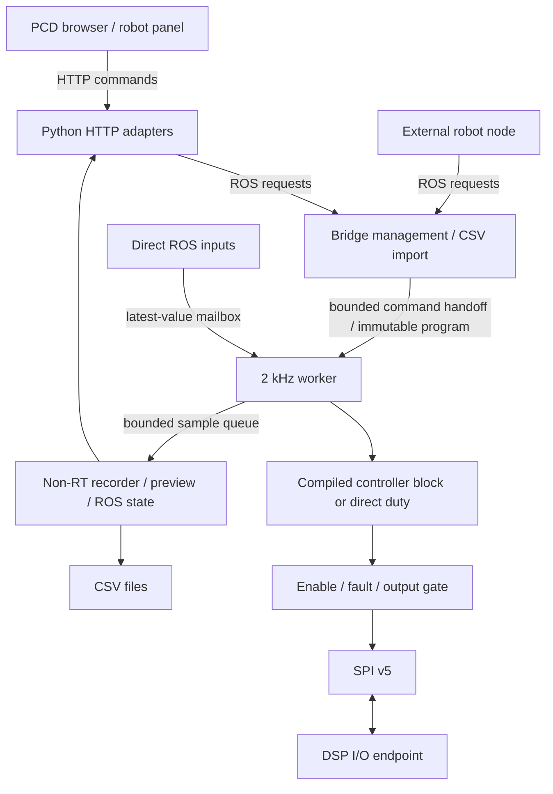

# Architecture

PCD controls one DSP with six motor/encoder channels, four DI, four DO, six AI and
two DAC outputs. The bench has calibrated position control on axes 0 and 1;
channels 2–5 support direct duty, with position control unconfigured by default.

## Execution boundaries

- `bridge`: one process. The 2 kHz worker is pinned to CPU 3 at FIFO priority 80
  on the Pi PREEMPT_RT kernel. Normal ROS callbacks, profile/program preparation,
  sample draining, previews and CSV writes run outside RT on CPUs 0–2.
- The worker applies commands, advances one program row, runs each active
  controller or direct-duty path, exchanges one SPI frame, and queues a snapshot.
  It does not parse CSV/YAML, allocate programs, call ROS or write files.
- `data_server`: Python CSV library/import services. Parses and checks uploads
  before transferring a typed, immutable program to the bridge. Not a tick timer.
- `ui_bridge`: ROS ↔ HTTP/WebSocket relay plus host diagnostics and file downloads.
  Browser lifetime never owns the realtime loop, recorder or program.
- `phantom_robot`: separate package under `robots/`, preparing experiments and
  serving its own panel. It calls the same runner/logger APIs as other clients.

Controllers receive calibrated reference/feedback and return signed normalized
DSP duty. The PID preserves count-based gains internally. Its optional reference
slew limiter is part of the controller block and profile, not bridge transport.
Direct duty bypasses the entire feedback controller. Calibration, motor polarity,
travel bounds, duty caps and fault gates remain explicit hardware configuration.

## Ownership and holding

Without a runner, continuous ROS inputs use latest-value, arrival-order semantics;
use one publisher per command channel. Publisher/browser disappearance holds the
last accepted value. No command lease is implemented.

A running or holding program owns only its listed motor/DO/AO channels. Conflicting
manual writes, mode/zero/limit changes are rejected. Other channels remain usable.
Stop All takes priority over queued enables/starts. Runner Stop releases and zeros
its outputs, disables its motors and ends its associated recording. A separate
manual recording is controlled independently.

## Feedback and recovery

CPU1 supplies a 5 kHz DSP snapshot. The 2 kHz host sees SPI pipeline delay; a row's
commands and the returned hardware acknowledgement need not refer to the same
instant. Record target/reference, DSP command acknowledgement and reported output
when studying that delay. All recorded fields come from one host snapshot with
one frame timestamp; there are no independent sensor timestamps.

`/dsp/state` preserves the DSP's raw values, masks and counters. `/bridge/state`
adds host control, timing, program and recording state and includes that same
DSP snapshot. Host `connected` means session synchronization; `bridge_alive` in
HTTP means the ROS state publisher is recent. Those are separate conditions.

DSP boot resets its existing session/time origin. The host resynchronizes while
disarmed, latches a host fault, establishes startup zeros and closes any recording
across the reset. Explicit fault clear and Start/enable are needed afterward.
Transient communication faults stop drive; reconnecting the browser does not.
No boot ID or reset-cause field has been added. DSP command timeout remains 50 ms;
CPU2 feedback availability expires after 10 ms. MCU hardware watchdog changes are
deferred. Full DSP behavior and wiring remain in the linked DSP hardware guide.
