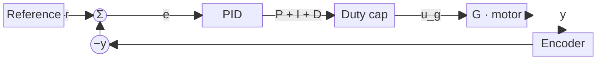

# PID

Reference applies the selected passthrough or slew limit. PID uses Kp, Ki, Kd and the configurable derivative filter. The duty cap and motor polarity determine the outgoing command.

The matched CSV channels carry the reference, input measurement, error, signed P/I/D contributions, controller output and motor duty command. The encoder position in the DSP response is a newer observation than the measurement used to calculate the acknowledged command.

Signals: `ctrl_r_mm`, `ctrl_y_mm`, `ctrl_error_counts`, `ctrl_p_duty`, `ctrl_i_duty`, `ctrl_d_duty`, `ctrl_u_duty`, `ctrl_u_g_duty`, `requested_duty`, `output_duty`, `position_mm`, `ctrl_valid`
