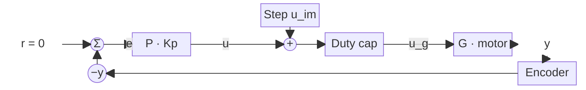

# Step Recorder

The step is in signed motor duty units and is added after feedback polarity. The motor input is the sum after applying the axis duty cap. Kp = 0 gives open-loop excitation. The DSP reports its own applied duty.

Signals: `ctrl_r_mm`, `ctrl_y_mm`, `ctrl_error_counts`, `ctrl_u_duty`, `ctrl_u_im_duty`, `ctrl_u_g_duty`, `requested_duty`, `output_duty`, `position_mm`, `ctrl_valid`
